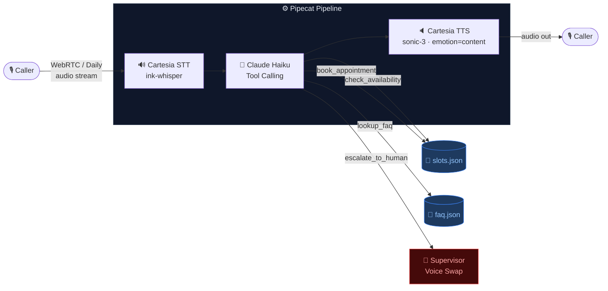
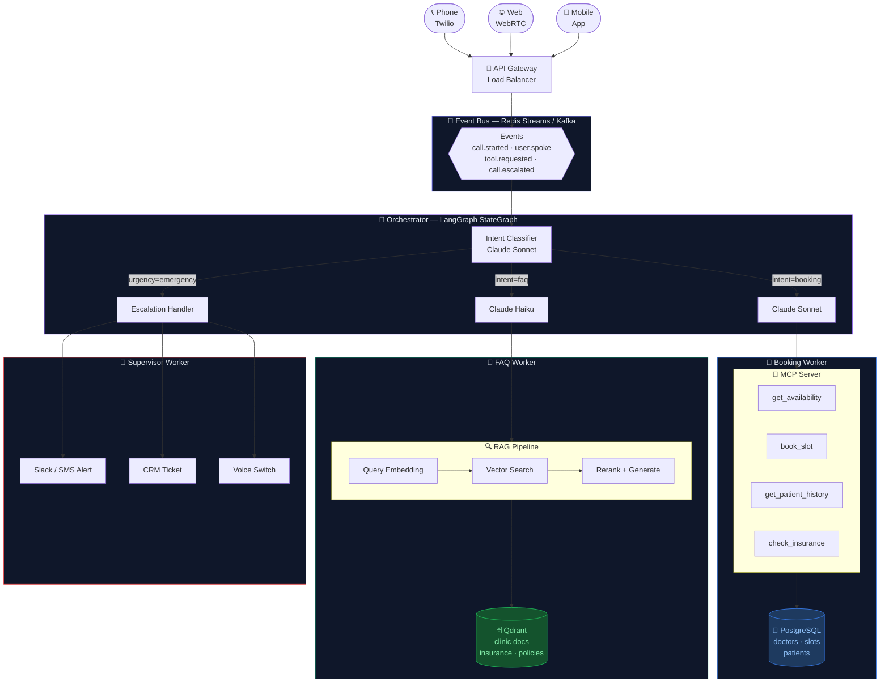
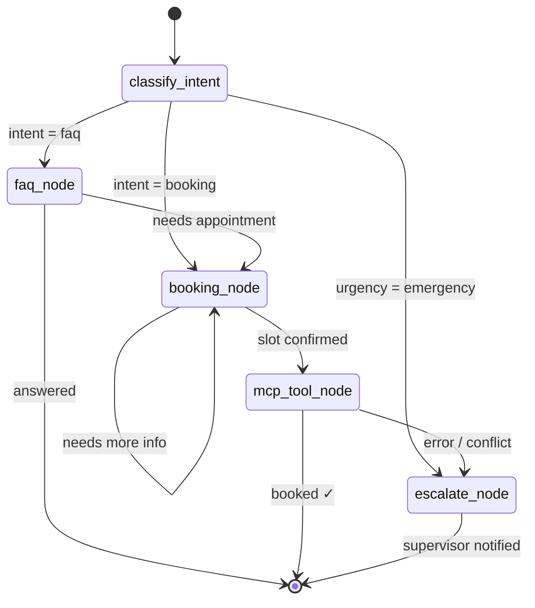

<div align="center">

# 🏥 Healthcare Voice Contact Center

**A production-quality, real-time voice AI agent for healthcare clinics.**  
Patients call in, speak naturally, and the AI handles bookings, FAQs, and emergencies — no hold music, no menus.

[](https://python.org)
[](https://anthropic.com)
[](https://pipecat.ai)
[](https://cartesia.ai)
[](LICENSE)

</div>

---

## ✨ What it does

| Capability | How |
|---|---|
| 📅 **Appointment booking** | Checks live availability, confirms name & phone, books the slot |
| 💬 **FAQ answering** | Clinic hours, insurance, billing, directions — instant |
| 🚨 **Emergency escalation** | Detects life-threatening keywords → switches to Supervisor voice + prompt |
| 🎙️ **Natural voice** | Warm human-like TTS with emotional tone, not robotic |
| 🔄 **Personality switching** | Front-desk Aria → Supervisor Marcus, live mid-call |

---

## 🏗️ Current Architecture (v1)

> Real-time single-pipeline voice agent — everything runs in one process.



**Key characteristics:**
- Single process, no queue, no external services (beyond APIs)
- Slots stored in `data/slots.json` — state persists across restarts
- VAD (Silero) waits **2.5 seconds** of silence before responding — comfortable for any speaking pace
- On escalation: `TTSUpdateSettingsFrame` swaps voice live + injects Supervisor system prompt

---

## 🚀 Production Architecture (v2 — Roadmap)

> Event-driven, multi-agent system with MCP tool layer, vector RAG, and LangGraph orchestration.



### LangGraph State Flow



---

## 📊 v1 vs v2 Comparison

| | v1 · Now | v2 · Production |
|---|:---:|:---:|
| **LLM agents** | 1 agent | Orchestrator + Workers |
| **Tool calling** | Direct Python fn | Via MCP Server |
| **Data store** | JSON file | PostgreSQL |
| **Knowledge base** | Keyword search | Vector RAG (Qdrant) |
| **Agent communication** | None | Event Bus (Redis/Kafka) |
| **Workflow engine** | Linear | LangGraph StateGraph |
| **Scalability** | Single process | Independent microservices |
| **Escalation** | Log to file | Webhook → CRM + Slack |

---

## ⚡ Quick Start

### Prerequisites

- Python **3.11+** · [uv](https://github.com/astral-sh/uv)
- [Anthropic API key](https://console.anthropic.com) — `ANTHROPIC_API_KEY`
- [Cartesia API key](https://cartesia.ai) — `CARTESIA_API_KEY`

### Setup

```bash
cd voice_agents/healthcare_contact_center
cp .env.example .env
# fill in your API keys in .env
uv sync
```

### Run

```bash
# WebRTC (default) — opens browser client
uv run python main.py

# Daily transport
uv run python main.py -t daily
```

Open **http://localhost:7860** in your browser and click Connect.

---

## 🎯 Try It

```
"I'd like to book an appointment with Dr. Patel."
"What insurance plans do you accept?"
"I want to speak to a manager."
"I'm having chest pain right now."   ← triggers emergency escalation
```

---

## 📁 Project Layout

```
healthcare_contact_center/
├── main.py               # Pipeline, VAD config, tool registration
├── personalities.py      # Prompts + Cartesia voice IDs (Aria & Marcus)
├── tools/
│   ├── appointments.py   # check_availability, book_appointment
│   ├── knowledge_base.py # lookup_faq — keyword search
│   └── escalation.py     # escalate_to_human — ticket + voice swap
└── data/
    ├── slots.json         # Mock appointment store (persisted on disk)
    └── faq.json           # Clinic policies and FAQ
```

---

## 🔧 Customizing

- **VAD sensitivity** — change `stop_secs` in `main.py` (default `2.5s`)
- **Voice tone** — change `emotion` in `GenerationConfig` (`content`, `happy`, `neutral`, ...)
- **LLM model** — swap `claude-haiku-4-5-20251001` for `claude-sonnet-4-6` for higher quality
- **Voices** — swap `FRONT_DESK_VOICE` / `SUPERVISOR_VOICE` with any [Cartesia voice ID](https://docs.cartesia.ai)
- **Real backend** — replace JSON ops in `tools/appointments.py` with your scheduling API

---

<div align="center">

Built with [Pipecat](https://pipecat.ai) · [Anthropic Claude](https://anthropic.com) · [Cartesia](https://cartesia.ai)

</div>
